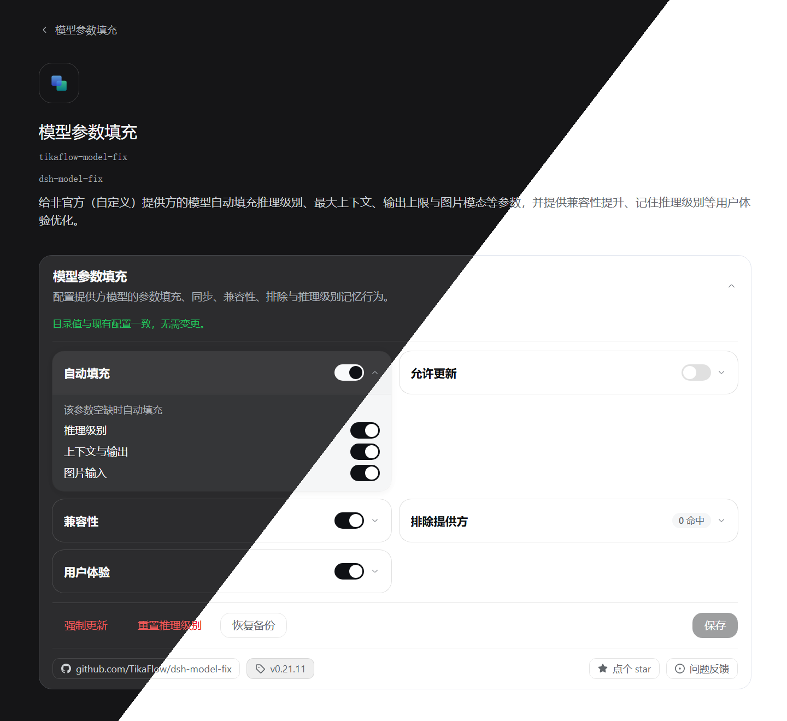

# dsh-model-fix

DSH[（DeepSeek Harness）](https://github.com/deepseek-ai/deepseek-harness) 插件：提供更好的模型使用体验，包括但不限于：多种方式填充模型参数、提升模型兼容性、记住推理级别、子智能体实时跟随模型和推理级别、AI 自主调节档位等。

> [!IMPORTANT]
> 如果觉得好用，请给个星哦~
> 你的支持是我继续开发的动力！也能让别人更容易找到这个插件。

> 本插件已在 [awesome-dsh-plugin](https://github.com/awesome-dsh-plugin/awesome-dsh-plugin) 收录，可在 [dsh-market](https://github.com/dsh-market/dsh-market) 中搜索、安装。

插件截图：



[更多截图](screenshots/)

## 功能

- 开箱即用：启动即以内置缓存填充（离线可用），缓存数据自动保持最新

本插件根据实际需求，提供以下功能：

- 添加了第三方模型，但是不知道推理级别、上下文窗口等参数？【自动填充】按 models.dev 数据补全模型参数（推理级别、上下文窗口、最大输出、图片模态），已有配置不受影响
- 第三方模型参数更新了，却不知道怎么填？【允许更新】自动更新模型参数（已有配置也会更新）
- 手动给模型添加推理级别后，发现请求报错？【禁用`developer`角色】系统提示词改用旧版兼容的`system`角色
- 请求体带 `store` 参数导致报错？【禁用`store`参数】请求体里不再带 `store` 键，兼容不认该参数的端点（如 LiteLLM 代理）
- 某个提供方的模型不想被插件接管？【排除提供方】本插件完全不动（填充、更新、兼容性写入、强制更新、重置推理级别等功能跳过），基本等效于对它关闭插件
- 切换到某个模型后，推理级别重置了，还需要手动再选择一次？【记住推理级别】每模型独立记住上次手动选择的推理级别，切换模型时自动恢复
- 感觉推理级别记忆问题？【清除记忆】关闭「记住推理级别」时询问是否确认清除记忆，可在清除后不保存设置，依然可以继续记忆，但旧记忆已清除
- 新配置的模型也不想自己选推理级别？【默认使用 high】切换模型时，若没有该模型的记忆，且模型提供 `high` 档位，则自动设为 `high`
- 不想已删除的模型还残留推理级别记忆？【忘记已删除模型】删除模型（或提供方）后其记忆随之清除；关闭后不做任何处理，记忆原样保留
- 子智能体启动后还想切换模型与推理级别？【跟随父智能体】子智能体的提供方、模型与推理级别实时同步父智能体（**关闭**「允许 Agent 为子智能体选择模型」时生效）
- 希望 AI 根据任务难度自己选择合适的推理级别？【自主调节档位】AI 可根据任务难度自主调节推理档位
- 没配官方 API 密钥，模型选择器里却挂着一组用不了的官方模型？【隐藏官方API】官方 API 未配置密钥时不在模型选择器中显示（DSH 较新版本已默认隐藏，无需开启）
- 推理级别的名字看着别扭？【本地化推理级别】模型选择器里的推理级别按界面语言显示名称
- 推理级别翻译后对不上原名称？【显示原档位名】在本地化推理级别时，还显示原档位名（如「最大 · Max」），方便对照。
- 自动填充效果不理想，总是填充不上？【尽量匹配】尽量给出一组合适的参数填充，**但无法保证准确**
- 目录里查不到模型容量，怕宿主按过大的默认值估？【安全填充】目录查不到容量、当前也没写时，补一组保守值（上下文 256K、输出上限 32K）
- 目录里查不到任何推理档位，模型选择器里没有档位可选？【总有推理】给它声明一条「关」档位，让选择器出现档位选项

UI界面还提供了一些额外功能：

- 强制更新：按模型缓存的当前值立即覆盖一遍
- 重置推理级别：删除所有模型的推理级别字段（可能触发【自动填充】）
- 恢复备份：回退到插件启动时已存在的模型参数（提供方已删除的不会恢复，已新增的不会删除）
- 验证模型：验证所选模型是否可用（每模型一次最小请求，只读不写配置；不支持的档位可用「探测档位」逐档试出）
- 探测档位：**【最真实】**勾选模型后逐个推理级别试出实际支持的档位（「选择未填充」一键勾好还没填档位的模型）；「自动写入」控制是否把结论写回
- **输入框快捷入口**：聊天输入框工具行常驻「模型优化」入口（点开弹完整配置卡）和「跟随」状态灯（点击即可开关）
- **悬浮按钮组**：内容区左侧的一组按钮：返回对话、插件图标；「返回对话」按钮会逐级返回到当前会话的「对话」页签
- **经典设置**：侧栏底部恢复为一枚直接的「设置」按钮（遮蔽宿主账号菜单，故意见反馈与登录入口不可见；在【UI 与行为】里关掉即恢复）
- **插件UI相关配置**：【UI 与行为】控制配置插件UI的行为，如设置卡片入口的位置、显示「跟随」状态灯、显示「返回对话」按钮、启用「经典设置」等。

### 可视化设置

- 入口：
  - 「设置」-->「模型」-->「模型参数填充」卡片（卡片默认收起）
  - 「设置」-->「内置插件」-->「模型填充」选项卡-->「模型参数填充」卡片
  - 「插件」-->「已安装插件」-->「模型参数填充」详情页
  - 「插件」-->「已安装插件」-->「模型参数填充」详情页-->「包含的组件」-->「dsh-model-fix」
  - 「输入框」-->「工具栏」-->「模型优化」入口

## 安装

> 以下所有安装方式安装的内容、效果完全相同。

### 方式一：通过插件市场安装（推荐）

> `dsh-market` 插件市场会自动处理本地构建审批、校验和冲突等问题。

直接在插件市场搜索我的用户名：`TikaFlow`，找到「dsh-model-fix」插件，即可安装。

### 方式二：通过 tarball 安装（推荐）

> [!NOTE]
> 已有用户安装/更新其他包时报 `ERR_PNPM_TARBALL_INTEGRITY`，且指出冲突源为本插件时，按以下方式恢复：
>
> **卸载重装**：在「插件」-->「已安装」中卸载本插件，再用方式二的固定版本链接重新安装，装到的即 README 所钉版本。

在 DSH 中，点击「插件」-->「添加插件」，复制以下链接到输入框，完成安装并立即启用：

```txt
https://github.com/TikaFlow/dsh-model-fix/releases/download/v0.36.20/dsh-model-fix.tgz
```

或在命令行执行：

```bash
dsh plugin --profile web add https://github.com/TikaFlow/dsh-model-fix/releases/download/v0.36.20/dsh-model-fix.tgz
```

### 方式三：通过 Git 安装（不推荐）

> 使用这种方式安装需要现场构建插件，不推荐。

```bash
dsh plugin --profile web add github:TikaFlow/dsh-model-fix
```

## 版本说明

DSH 正在快速迭代，本插件所兼容的 DSH 宿主版本追随较新版本。若插件功能异常，请检查 DSH 版本是否满足插件依赖版本。

支持范围：DSH `0.1.7-rc.2` ~ `0.2.2-alpha.2`

## 使用说明

无需任何操作，进入 DSH 后插件即自动生效：自动填充缺失的模型参数，并记住用户手动选择的推理级别。某个提供方不想被接管，就把它的 id 加进「排除提供方」。

### 配置

**图形界面（推荐）**：见 [可视化设置](#可视化设置)

**手动编辑**（等效方式）：Web 设置界面右上角「打开配置文件 / Open configuration file」直接编辑 `cordis.patch.yml`：

```yaml
- id: tikaflow-model-fix
  name: dsh-model-fix
  config:
    version-8:
      autoFill:           # 自动填充缺失的字段
        reasoning: true
        context: true
        image: true
      allowUpdate:        # 允许更新已有模型的字段
        reasoning: false
        context: false
        image: false
      compat:             # 兼容性
        disableDeveloper: true
        disableStore: true
      excludes: []        # 排除的提供方 id 列表
      efforts: {}         # 每模型推理级别记忆
      userExperience:     # 用户体验，对所有提供方生效，不支持排除
        rememberEfforts: true
        defaultHigh: true
        forgetRemoved: true
        followParent: false
        selfTune: false
        hideOfficial: true
        localizeEfforts: true
        showOriginalEfforts: true
        looseMatch: false
        safeFill: false
        alwaysReasoning: false
      behavior:           # 界面显示与行为
        showInModels: true
        showInBuiltinPlugins: true
        showInComposer: true
        showInFloat: true
        showFollowStatus: true
        backToChat: true
        classicSetting: true
```
